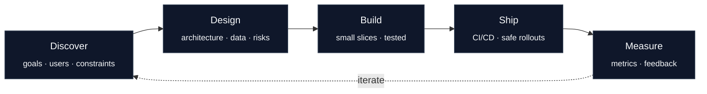
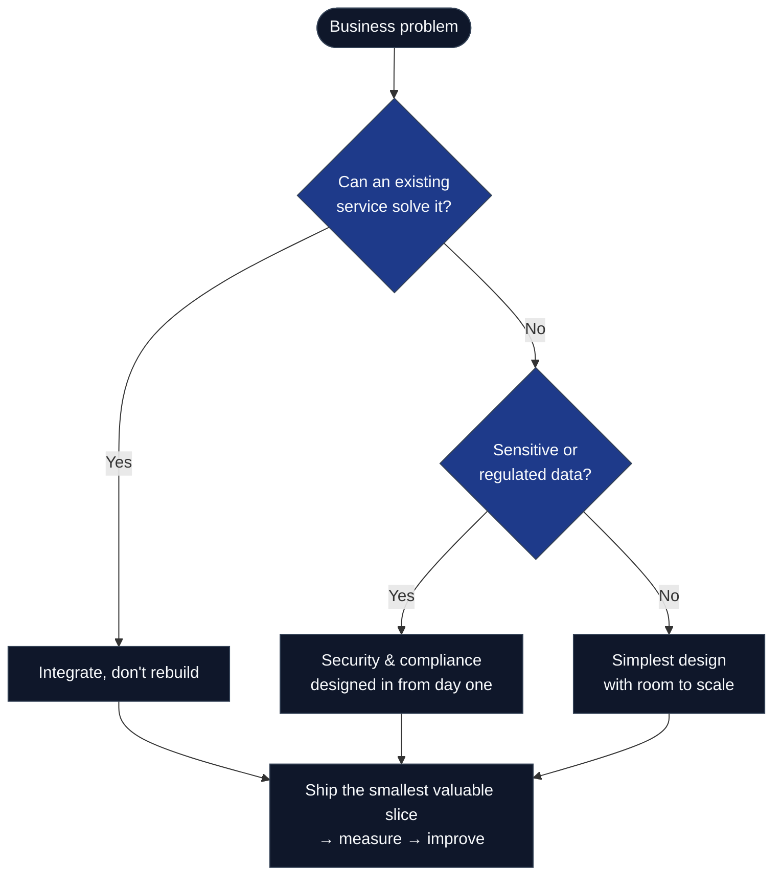
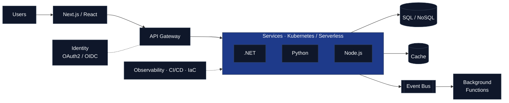

  

  I design and build secure, scalable software for regulated industries — 
  taking products from first MVP to enterprise-grade platforms.

  
  

---

### Focus

| Industries | What I deliver |
|:--|:--|
| **Fintech** · **Insurance** · **Healthcare** · **Legal Tech** · **SaaS** | Customer platforms, internal tools, public APIs, data pipelines, legacy modernization, cloud migration |

---

### Tech Stack

| | |
|:--|:--|
| **Languages** |  |
| **.NET** |  &nbsp; `ASP.NET Core` `Web API` `EF Core` `Blazor` `SignalR` `CQRS / MediatR` |
| **Python** |  &nbsp; `DRF` `Celery` `Pydantic` `SQLAlchemy` `Pandas` |
| **JavaScript** |  &nbsp; `Redux` `React Query` `Prisma` |
| **Cloud** |  &nbsp; `Azure Functions` `AWS Lambda` `Cloud Run` `API Gateway` `Service Bus` `SQS` |
| **DevOps** |  &nbsp; `Helm` `Azure DevOps` `Bicep` `OpenTelemetry` `Grafana` |
| **Data** |  &nbsp; `SQL Server` `Cosmos DB` `DynamoDB` `BigQuery` |
| **Security** | `OAuth 2.0 / OIDC` `Entra ID` `Auth0` `Key Vault / Secrets Manager` `HIPAA` `PCI DSS` `SOC 2` |
| **Testing** | `xUnit` `Pytest` `Jest` `Playwright` `Contract testing` |

---

### How I Work

### How I Make Decisions

---

### Typical Architecture

---

### Engineering Principles

| Principle | In practice |
|:--|:--|
| **Outcomes over output** | Every feature ties back to a user or business result |
| **Simple first, scalable next** | Clear boundaries so growth is a refactor, not a rewrite |
| **Secure by default** | Least privilege, encryption, secrets management, audit trails |
| **Observable systems** | Logs, metrics and traces ship with every feature |
| **No surprises** | Written designs, honest estimates, early risk flags |

---

### GitHub Activity

  
  

  <picture>
    <source media="(prefers-color-scheme: dark)" srcset="https://raw.githubusercontent.com/stuff-builder/stuff-builder/output/github-contribution-grid-snake-dark.svg" />
    
  </picture>

---

  Have a product to launch, a platform to scale, or a system to modernize? &nbsp;·&nbsp; <a href="https://www.linkedin.com/in/raymond-thomas-jr/">Let's talk</a>

