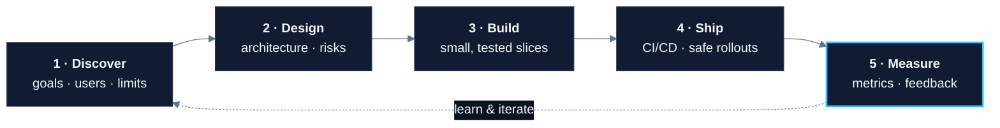
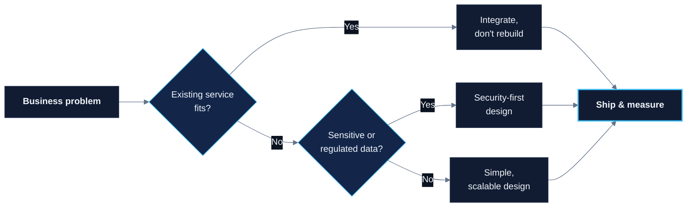
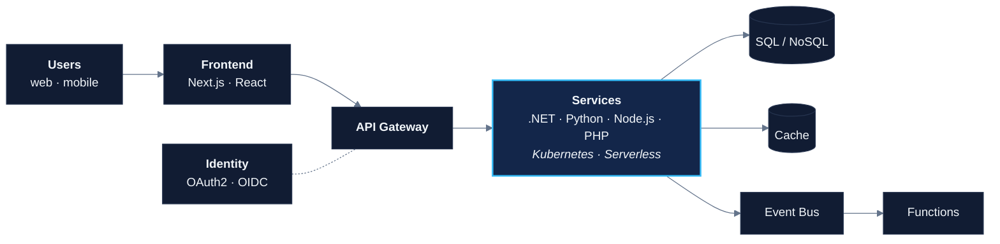

  

  

  I design and build secure, scalable software for regulated industries, 
  taking products from first MVP to enterprise-grade platforms.

  
  

---

## Industries

      

**What I deliver**

       

---

## Tech Stack

**Languages**

  

**.NET**

  
   
       

**Python**

  
   
      

**PHP**

  
   
      

**CMS & E-commerce**

  
   
        

**JavaScript / TypeScript**

  
   
    

**Cloud & Serverless**

  
   
       

**DevOps**

  
   
      

**Data & Messaging**

  
   
     

**Security & Compliance**

        

**Testing**

     

---

## How I Work

### How I Make Decisions

### Typical Architecture

Observability · CI/CD · Infrastructure as Code · Secrets Management across every layer

---

## Engineering Principles

- **Outcomes over output:** every feature ties back to a user or business result
- **Simple first, scalable next:** clear boundaries so growth is a refactor, not a rewrite
- **Secure by default:** least privilege, encryption, secrets management, audit trails
- **Observable systems:** logs, metrics and traces ship with every feature
- **No surprises:** written designs, honest estimates, early risk flags

---

## GitHub Activity

  <picture>
    <source media="(prefers-color-scheme: dark)" srcset="https://raw.githubusercontent.com/stuff-builder/stuff-builder/output/github-contribution-grid-snake-dark.svg" />
    
  </picture>

---

  <b>Have a product to launch, a platform to scale, or a system to modernize?</b> 
  <a href="https://www.linkedin.com/in/raymond-thomas-jr/">Let's talk on LinkedIn →</a>

  

