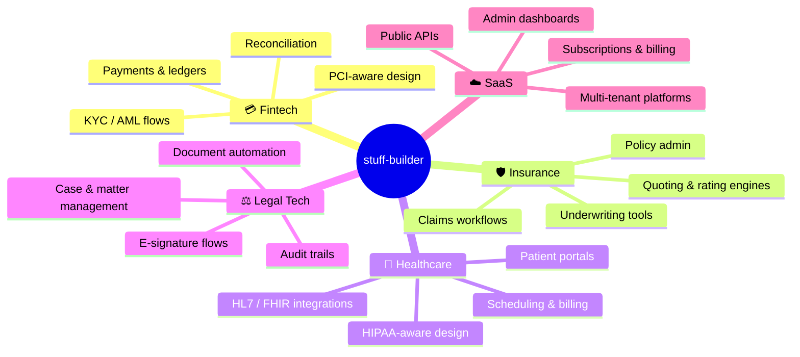
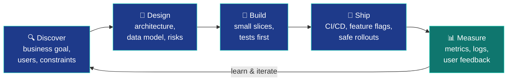
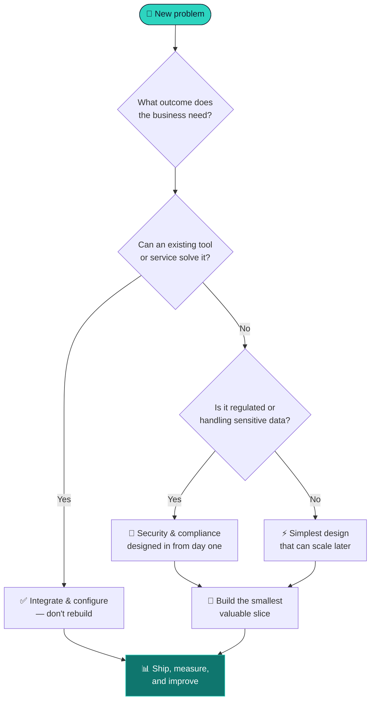
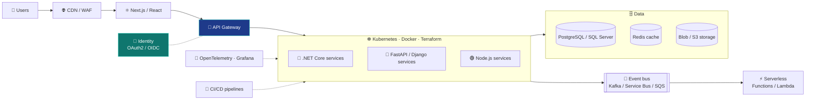
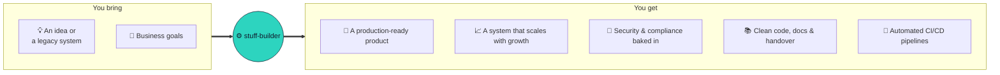

<!-- ============================== HEADER ============================== -->

  

  

  
  
  

---

## 🧭 At a Glance

| 🏗️ I build | 🎯 For | ⚙️ With |
|:--|:--|:--|
| Web platforms, APIs, data pipelines, internal tools | Startups shipping their first product & enterprises modernizing legacy systems | .NET, Python, JavaScript/TypeScript on Azure, AWS & GCP |
| Secure, auditable, compliant systems | Fintech · Insurance · Healthcare · Legal Tech · SaaS | Containers, serverless, CI/CD & infrastructure as code |

---

## 🏢 Industries I Build For

---

## 🛠️ Tech Stack

### 💻 Languages

  

### 🔷 .NET Ecosystem

  
   
  
  
  
  
  
  
  

### 🐍 Python Ecosystem

  
   
  
  
  
  
  
  

### ⚡ JavaScript / TypeScript Ecosystem

  
   
  
  
  
  
  

### ☁️ Cloud & Serverless

  
   
  
  
  
  
  
  
  

### 🚢 DevOps & Infrastructure

  
   
  
  
  
  
  
  

### 🗄️ Data, Messaging & Search

  
   
  
  
  
  

### 🔐 Security & Identity

  
  
  
  
  
  
  

---

## 🔄 How I Work

---

## 🧠 How I Think Through a Problem

### 📌 Engineering Principles

| | Principle | In practice |
|:--:|:--|:--|
| 🎯 | **Outcomes over output** | Every feature ties back to a user or business metric |
| 🧱 | **Simple first, scalable next** | Start lean, keep clear seams so scaling is a refactor, not a rewrite |
| 🔐 | **Secure by default** | Least privilege, encryption, secrets management and audit logs from the start |
| 🧪 | **Tests are the safety net** | Unit, integration and end-to-end tests guard every deploy |
| 🔭 | **If it isn't observed, it isn't done** | Logs, metrics and traces ship with the feature |
| 🤝 | **Clear communication** | Written designs, honest estimates and early warnings, never surprises |

---

## 🏛️ Reference Architecture I Deliver

---

## 📦 What Clients Get

---

## 📊 GitHub Activity

  
  

  

  

---

## 🐍 Contribution Snake

  <picture>
    <source media="(prefers-color-scheme: dark)" srcset="https://raw.githubusercontent.com/stuff-builder/stuff-builder/output/github-contribution-grid-snake-dark.svg" />
    <source media="(prefers-color-scheme: light)" srcset="https://raw.githubusercontent.com/stuff-builder/stuff-builder/output/github-contribution-grid-snake.svg" />
    
  </picture>

---

## 🤝 Let's Build Something

  <b>Have a product to launch, a platform to scale, or a legacy system to modernize?</b> 
  I'd love to hear about it.

  

<!-- ============================== FOOTER ============================== -->

  

